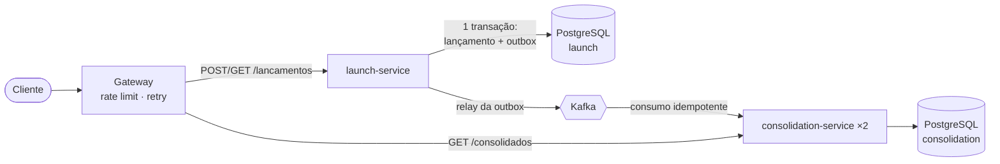

# Cash Flow Platform

Controle de fluxo de caixa de um comerciante: registro de lançamentos (débitos e créditos) e saldo diário consolidado.

Solução para o desafio de Arquiteto de Soluções. As decisões de arquitetura estão documentadas em [`docs/`](docs/), e o código implementa a arquitetura alvo de forma executável: a stack completa sobe com um único comando.



<sub>Versão em imagem: [00-visao-geral.svg](docs/diagrams/00-visao-geral.svg)</sub>

## Principais decisões

Resumo de como cada requisito central foi tratado. Os detalhes e as alternativas descartadas estão nos [ADRs](docs/adr/).

| Requisito | Decisão | Evidência |
|---|---|---|
| Lançamentos não podem cair se o consolidado cair | Dois serviços com bancos próprios, integração assíncrona e Transactional Outbox. O launch não depende nem do broker. | `e2e-resilience.sh`: 100/100 aceitos com o consolidado fora; saldo exato ao voltar |
| Consolidado com 50 req/s e ≤ 5% de perda | Read model pré-agregado, cache de TTL curto, réplicas sem estado, gateway com retry e rate limit | k6: 0% de erro, p95 de 4,5 ms a 50 req/s; 0% a 150 req/s; 0% com uma réplica morta durante a carga |
| Dinheiro não pode duplicar nem sumir | Idempotência na API (`Idempotency-Key`) e no consumidor (`event_id` na mesma transação do saldo); `NUMERIC(19,2)` | Testes com 10 POSTs concorrentes e 400 entregas paralelas |
| Correções auditáveis | Lançamentos imutáveis; correção por estorno | `EntryApiIT.estornaUmaUnicaVez` |

## Como rodar

Pré-requisitos: Docker (com Compose v2). Para os scripts: `curl` e `jq`. Para rodar testes fora do Docker: JDK 21 e Maven 3.9.

```bash
git clone https://github.com/eniglio-ctrl/cash-flow-platform.git && cd cash-flow-platform
docker compose up -d --build --wait
```

O primeiro build baixa as dependências Maven dentro do container (alguns minutos). Depois disso:

| O quê | URL |
|---|---|
| API (via gateway) | http://localhost:8080 |
| Swagger UI (as duas APIs, com "Try it out") | http://localhost:8080/swagger/ |
| Contratos OpenAPI | http://localhost:8080/openapi/launch.json · http://localhost:8080/openapi/consolidation.json (cópias versionadas em [`docs/api/`](docs/api/)) |
| Grafana (dashboard "Cashflow — Visão geral") | http://localhost:3000 |
| Prometheus | http://localhost:9090 |
| Jaeger (traces) | http://localhost:16686 |

> Se alguma porta estiver ocupada, todas são configuráveis: `GATEWAY_PORT=18080 GRAFANA_PORT=13000 PROMETHEUS_PORT=19090 JAEGER_PORT=26686 docker compose up -d --build --wait`. Ao mudar a porta do gateway, exporte também `BASE_URL=http://localhost:18080` antes de rodar os scripts.

### Demonstração

```bash
./scripts/demo.sh
```

Esse script obtém um token, registra um crédito e um débito, estorna o débito e mostra o consolidado do dia.

### Cenário crítico (consolidado fora do ar)

```bash
./scripts/e2e-resilience.sh
```

### Teste de carga (50 req/s e 150 req/s)

```bash
docker compose --profile loadtest run --rm k6
```

### Testes automatizados

```bash
mvn verify
```

São 25 testes: unitários e de integração com PostgreSQL e Kafka reais via Testcontainers (requer Docker).

### Encerrar

```bash
docker compose down -v
```

## API

Todas as rotas exigem `Authorization: Bearer <jwt>`. Localmente, o token é obtido em `POST /dev/token`, que existe só no profile `local` e substitui o IdP. O comerciante é sempre o `sub` do token.

```bash
TOKEN=$(curl -s -X POST localhost:8080/dev/token | jq -r .access_token)

# Registrar (Idempotency-Key obrigatória: reenviar a mesma chave não duplica)
curl -X POST localhost:8080/api/v1/lancamentos \
  -H "Authorization: Bearer $TOKEN" -H 'Content-Type: application/json' \
  -H 'Idempotency-Key: venda-0001-2026-10-13' \
  -d '{"date":"2026-10-13","type":"CREDIT","amount":150.75,"description":"Venda balcão"}'

# Consolidado do dia
curl localhost:8080/api/v1/consolidados/2026-10-13 -H "Authorization: Bearer $TOKEN"
```

| Método | Rota | Escopo | Descrição |
|---|---|---|---|
| POST | `/api/v1/lancamentos` | `lancamentos:write` | Registra crédito/débito. 201 novo · 200 reenvio idempotente · 409 chave reutilizada com outro payload · 422 regra de negócio |
| POST | `/api/v1/lancamentos/{id}/estornos` | `lancamentos:write` | Estorna (lançamento inverso na data de hoje) |
| GET | `/api/v1/lancamentos/{id}` | `lancamentos:read` | Consulta lançamento |
| GET | `/api/v1/lancamentos?date=AAAA-MM-DD&page&size` | `lancamentos:read` | Lista por data |
| GET | `/api/v1/consolidados/{data}` | `consolidado:read` | Saldo inicial, créditos, débitos, líquido, saldo final |
| GET | `/api/v1/consolidados?from&to` | `consolidado:read` | Período (máx. 31 dias) |
| POST | `/api/v1/admin/dlq/replay?max=100` | `consolidado:admin` | Reprocessa eventos da DLQ |

Exemplo de resposta do consolidado:

```json
{
  "date": "2026-10-13",
  "openingBalance": 0.00,
  "totalCredits": 620.40,
  "totalDebits": 120.40,
  "netAmount": 500.00,
  "closingBalance": 500.00,
  "entriesCount": 3,
  "lastUpdatedAt": "2026-10-13T21:51:50.797375Z"
}
```

### Testando pelo navegador (Swagger UI)

Acesse http://localhost:8080/swagger/. A página já abre autorizada: no ambiente local ela obtém sozinha um token de teste em `POST /dev/token` e o reaproveita até expirar. O seletor no topo alterna entre as APIs de Lançamentos e de Consolidado diário.

1. Em Lançamentos, abra `POST /api/v1/lancamentos` e clique em Execute. O corpo e a `Idempotency-Key` já vêm preenchidos com exemplos. Executar de novo com a mesma chave devolve 200 com o lançamento original, o que demonstra a idempotência.
2. Em Consolidado diário, execute `GET /api/v1/consolidados/{date}` com a data do lançamento.

Para testar outro comerciante, use Authorize > Logout e recarregue a página.

As chamadas passam pelo gateway, com o mesmo roteamento e rate limit do uso real. Os contratos OpenAPI 3 ficam versionados em [`docs/api/`](docs/api/) e também são servidos em `/openapi/*.json`.

## Documentação de arquitetura

| # | Documento | Conteúdo |
|---|---|---|
| 1 | [Domínios e capacidades](docs/01-dominio-e-capacidades.md) | Mapa de capacidades, subdomínios (core/genérico), linguagem ubíqua, context map |
| 2 | [Requisitos](docs/02-requisitos.md) | Premissas, RF, regras de negócio, RNF com metas mensuráveis, interpretação dos 5% |
| 3 | [Arquitetura alvo](docs/03-arquitetura-alvo.md) | C4 contexto/containers, sequências, modelo de dados, contrato do evento, escalabilidade, matriz de falhas, stack, implantação AWS |
| 4 | [Segurança](docs/04-seguranca.md) | STRIDE, authN/authZ, critérios de segurança para integração de serviços |
| 5 | [Observabilidade](docs/05-observabilidade.md) | Métricas, SLOs, alertas, health checks, runbook |
| 6 | [Arquitetura de transição](docs/06-arquitetura-de-transicao.md) | Migração de legado: Strangler Fig + ACL + CDC em fases |
| 7 | [Custos](docs/07-custos.md) | Estimativa AWS sa-east-1 por ambiente, licenças, alavancas de economia |
| 8 | [Testes e resultados](docs/08-testes-e-resultados.md) | Pirâmide, casos relevantes, resultados de carga e resiliência |
| 9 | [Evoluções futuras](docs/09-evolucoes-futuras.md) | Roadmap e decisões a revisitar |
| — | [ADRs](docs/adr/) | 10 decisões com contexto, alternativas e consequências |
| — | [Diagramas](docs/diagrams/) | Todos os diagramas exportados em SVG e PNG |
| — | [Contratos OpenAPI](docs/api/) | Especificação das duas APIs |

## Estrutura do repositório

```
cash-flow-platform/
├── services/
│   ├── launch-service/          # Contexto Gestão de Lançamentos (API + Outbox relay)
│   └── consolidation-service/   # Contexto Consolidação (consumer + read model + API de leitura)
├── infrastructure/
│   ├── gateway/                 # nginx: roteamento, rate limit, retry, Swagger UI
│   ├── prometheus/              # scrape + regras de alerta (SLOs)
│   └── grafana/                 # datasource e dashboard provisionados
├── loadtest/                    # k6 (50 e 150 req/s) + resultados
├── scripts/                     # demo e cenário e2e de resiliência
├── docs/                        # arquitetura, requisitos, ADRs, custos...
├── docker-compose.yml
├── Dockerfile                   # build multi-stage (SERVICE=launch-service|consolidation-service)
└── .github/workflows/ci.yml     # build, testes, e2e e carga no CI
```

Cada serviço segue camadas simples: `domain` (regras, sem framework) → `application` (casos de uso, transações) → `api` / `infrastructure` (HTTP, JDBC, Kafka, segurança).

## Stack

Java 21 · Spring Boot 3.5 · PostgreSQL 16 · Apache Kafka 3.9 (KRaft) · Flyway · Caffeine · nginx · Micrometer/Prometheus/Grafana · OpenTelemetry/Jaeger · JUnit 5 · Testcontainers · k6 · Docker Compose · GitHub Actions. Justificativas em [docs/03 §3.9](docs/03-arquitetura-alvo.md#39-stack-e-justificativas) e nos [ADRs](docs/adr/).
