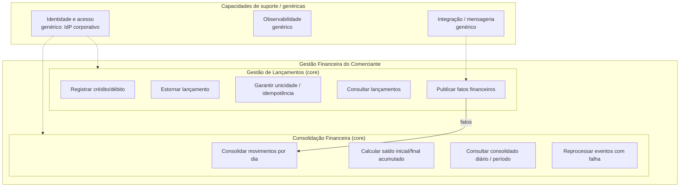
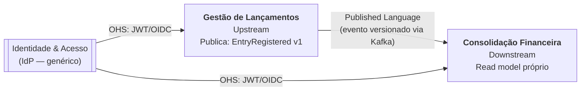

# 1. Domínios funcionais e capacidades de negócio

## 1.1 Problema

Um comerciante precisa registrar diariamente as entradas (créditos) e saídas (débitos) de caixa e consultar o saldo diário consolidado. São duas capacidades com naturezas diferentes:

| | Registrar lançamentos | Consolidar saldo |
|---|---|---|
| Natureza | Escrita, transacional, fonte da verdade | Leitura, derivada, recalculável |
| Consistência exigida | Forte (ACID) | Eventual é aceitável |
| Criticidade | Alta: parar = perder venda/registro | Média: atraso de segundos é tolerável |
| Perfil de carga | Escritas distribuídas ao longo do dia | Picos de leitura (50 req/s) |
| Pode ficar fora? | Não (RNF explícito) | Sim, sem afetar o registro |

Essa assimetria é o principal motor da arquitetura: as capacidades são separadas em contextos com ciclos de vida, escalas e níveis de disponibilidade independentes.

## 1.2 Mapa de capacidades

Versão em imagem: [01-mapa-de-capacidades.svg](diagrams/01-mapa-de-capacidades.svg)

| Subdomínio | Classificação | Justificativa | Estratégia |
|---|---|---|---|
| Gestão de Lançamentos | Core | É o registro contábil do negócio; regras próprias (imutabilidade, estorno, idempotência). | Desenvolvimento próprio |
| Consolidação Financeira | Core | É o produto que o comerciante consome; regra de saldo acumulado. | Desenvolvimento próprio |
| Identidade e Acesso | Genérico | Problema resolvido pelo mercado. | Comprar/usar IdP (Keycloak, Entra ID, Cognito) |
| Mensageria, Observabilidade | Genérico | Infraestrutura. | Serviços gerenciados / OSS |

## 1.3 Linguagem ubíqua

| Termo | Definição |
|---|---|
| Lançamento | Fato financeiro imutável: crédito ou débito, com valor positivo, data financeira e descrição. |
| Crédito | Entrada de dinheiro no caixa. |
| Débito | Saída de dinheiro do caixa. |
| Data financeira | Dia a que o lançamento pertence, no fuso do comerciante (`America/Sao_Paulo`), e não no momento técnico em que foi gravado. |
| Estorno | Lançamento de tipo oposto e mesmo valor que anula um lançamento anterior. É a única forma de "corrigir" um lançamento. |
| Chave de idempotência | Identificador enviado pelo cliente que garante que a mesma intenção de lançamento seja gravada uma única vez. |
| Consolidado diário | Visão derivada de um dia: saldo inicial, total de créditos, total de débitos, resultado líquido e saldo final. |
| Saldo inicial | Soma de todos os resultados líquidos dos dias anteriores. |
| Saldo final | Saldo inicial + créditos − débitos do dia. |
| Comerciante (merchant) | Titular do caixa; fronteira de isolamento dos dados (tenant). |

## 1.4 Bounded contexts e context map

Versão em imagem: [02-context-map.svg](diagrams/02-context-map.svg)

- Relação Lançamentos → Consolidação: *Customer/Supplier* com Published Language. O contrato é o evento `EntryRegistered` (v1), não o banco nem a API interna. A Consolidação não acessa o banco de Lançamentos.
- Consolidação é conformista em relação ao evento: ela não traduz o modelo, apenas o projeta num read model próprio. Se o contrato evoluir de forma incompatível, publica-se `v2` em paralelo (ver [ADR-0008](adr/0008-contrato-de-eventos-versionado.md)).
- Identidade: Open Host Service padrão (OIDC/JWT). O `merchant_id` vem do token (`sub`) e nunca do payload.

## 1.5 Responsabilidades por contexto

Gestão de Lançamentos (`launch-service`)
- Validar e registrar créditos e débitos, aplicando as regras de negócio (RN-01 a RN-07).
- Garantir idempotência por `(comerciante, Idempotency-Key)`.
- Estornar lançamentos.
- Gravar o lançamento e o evento na mesma transação (Outbox) e publicar no broker.
- Consultar lançamentos por id e por data.

Consolidação Financeira (`consolidation-service`)
- Consumir `EntryRegistered` de forma idempotente e atualizar o read model diário.
- Calcular o saldo inicial e final acumulados.
- Servir consultas por dia e por período com baixa latência.
- Encaminhar eventos inválidos para a DLQ e permitir reprocessamento.
