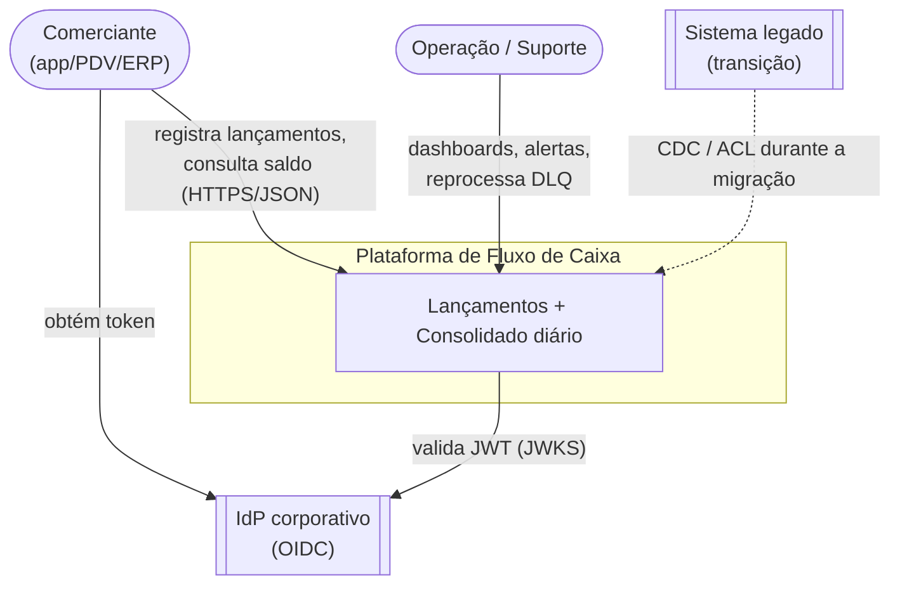
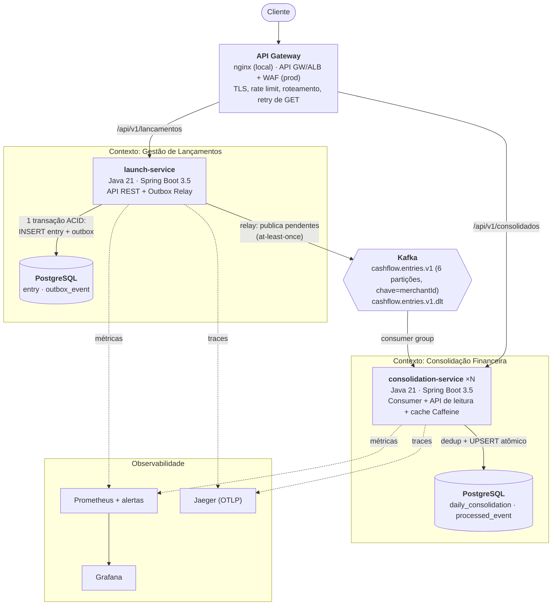
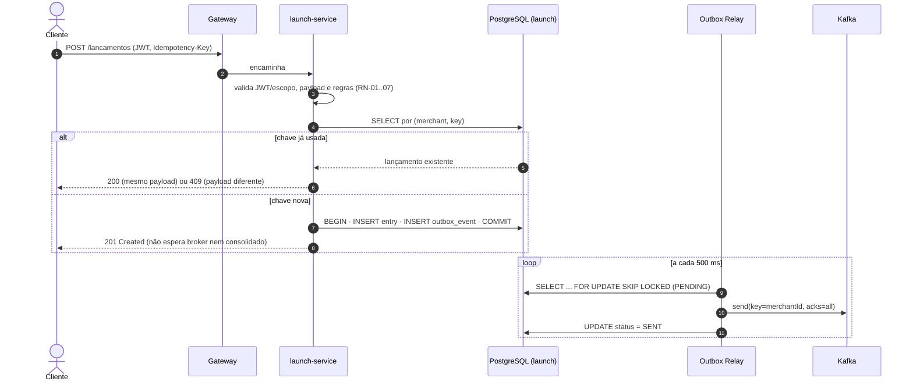
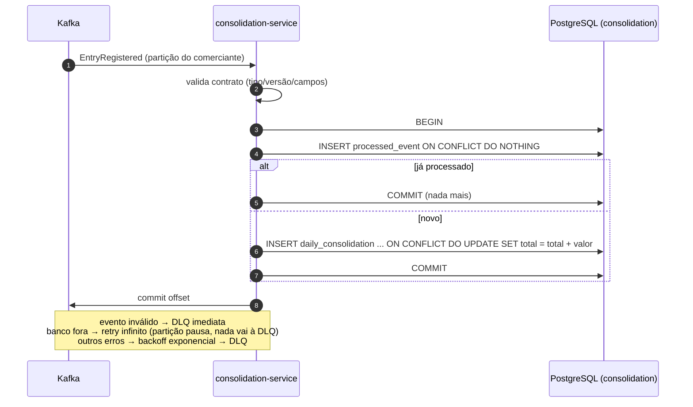
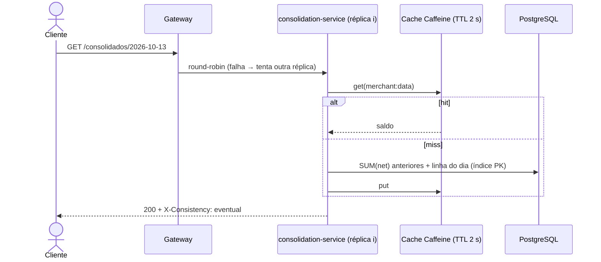
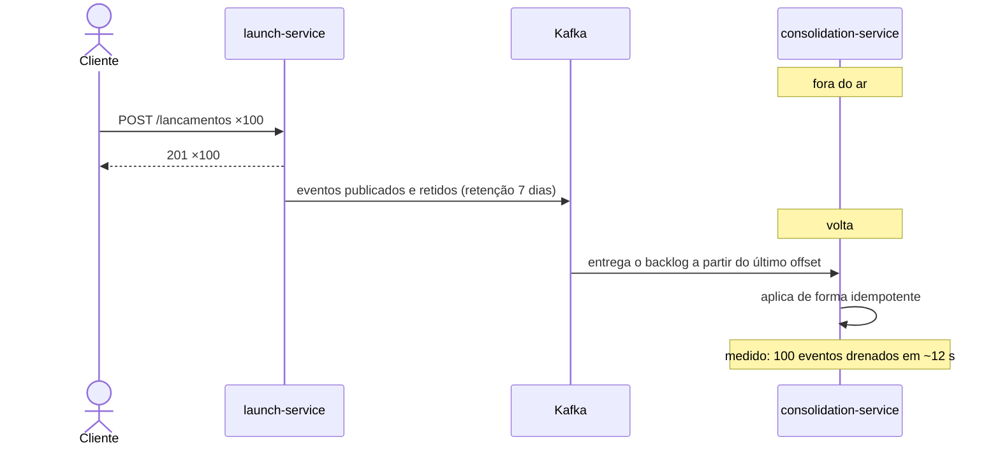
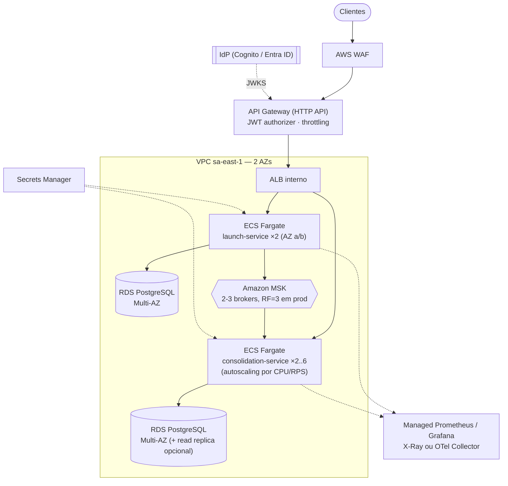

# 3. Arquitetura alvo

## 3.1 Visão geral

Dois microsserviços alinhados aos bounded contexts, cada um com banco próprio, integrados de forma assíncrona por eventos com Transactional Outbox e consumo idempotente. O caminho de leitura do consolidado é um read model pré-calculado (CQRS leve), escalado horizontalmente atrás de um gateway.

O ponto central do desenho: o serviço de lançamentos não tem dependência síncrona de nenhum outro serviço, nem do broker. Ele precisa apenas do próprio banco para aceitar um lançamento.

## 3.2 Diagrama de contexto (C4 nível 1)



<sub>Versão em imagem: [03-c4-contexto.svg](diagrams/03-c4-contexto.svg)</sub>

## 3.3 Diagrama de containers (C4 nível 2)



<sub>Versão em imagem: [04-c4-containers.svg](diagrams/04-c4-containers.svg)</sub>

## 3.4 Fluxos principais

### Registro de lançamento



<sub>Versão em imagem: [05-seq-registro-lancamento.svg](diagrams/05-seq-registro-lancamento.svg)</sub>

### Consolidação



<sub>Versão em imagem: [06-seq-consolidacao.svg](diagrams/06-seq-consolidacao.svg)</sub>

### Consulta do consolidado (caminho dos 50 req/s)



<sub>Versão em imagem: [07-seq-consulta-consolidado.svg](diagrams/07-seq-consulta-consolidado.svg)</sub>

### Consolidado fora do ar (RNF-01)



<sub>Versão em imagem: [08-seq-consolidado-indisponivel.svg](diagrams/08-seq-consolidado-indisponivel.svg)</sub>

## 3.5 Modelo de dados

launch (fonte da verdade)

| Tabela | Colunas principais | Restrições |
|---|---|---|
| `entry` | id, merchant_id, idempotency_key, request_hash, entry_date, type, amount `NUMERIC(19,2)`, description, reversal_of, created_at | `UNIQUE(merchant_id, idempotency_key)`, `UNIQUE(reversal_of)`, `CHECK amount > 0` |
| `outbox_event` | id (= eventId), aggregate_id, partition_key, event_type, payload `JSONB`, status, attempts, last_error, created_at, published_at | índice parcial `WHERE status='PENDING'` |

consolidation (read model, reconstruível a partir dos eventos)

| Tabela | Colunas | Restrições |
|---|---|---|
| `daily_consolidation` | merchant_id, balance_date, total_credits, total_debits, entries_count, updated_at | `PK(merchant_id, balance_date)` |
| `processed_event` | event_id, entry_id, processed_at | `PK(event_id)`, `UNIQUE(entry_id)` |

O saldo inicial não é armazenado: é `SUM(credits − debits)` dos dias anteriores, calculado na leitura sobre a PK. Assim, um lançamento retroativo (RN-04) não exige reescrever os dias seguintes. O custo da leitura é O(dias com movimento do comerciante) e é amortizado pelo cache. Quando o histórico crescer, a evolução prevista é um snapshot mensal de saldo ([09-evolucoes-futuras.md](09-evolucoes-futuras.md)).

### Contrato do evento `EntryRegistered` v1

```json
{
  "eventId": "6f1c…",            "eventType": "EntryRegistered",  "version": 1,
  "entryId": "3c57…",            "merchantId": "5396…",
  "entryDate": "2026-10-13",     "type": "DEBIT",                 "amount": "120.40",
  "reversalOf": null,            "occurredAt": "2026-10-13T21:51:50.157Z"
}
```

Chave Kafka = `merchantId` (ordem por comerciante). Headers: `eventId` e `eventType`. O valor trafega como string para não perder precisão.

## 3.6 Escalabilidade e desempenho

| Mecanismo | Onde | Efeito |
|---|---|---|
| Serviços sem estado + N réplicas | ambos | escala horizontal linear |
| Read model pré-agregado (1 linha/dia) | consolidação | consulta por PK, sem somar lançamentos na hora |
| Cache local Caffeine, TTL 2 s | consolidação | absorve picos de consulta repetida; a defasagem extra é desprezível frente à consistência eventual |
| Partições por `merchantId` (6) | Kafka | até 6 consumidores paralelos mantendo a ordem por comerciante |
| `FOR UPDATE SKIP LOCKED` | relay da Outbox | várias instâncias do launch sem publicação duplicada concorrente |
| UPSERT atômico no banco | consolidação | sem lock na aplicação nem read-modify-write |
| Virtual threads (Java 21) | ambos | alta concorrência de I/O com pouco custo |
| Pool de conexões limitado (Hikari) | ambos | protege o banco sob pico |
| Rate limit por token no gateway | borda | um cliente abusivo recebe 429 sem degradar os demais |

Dimensionamento: 50 req/s com p95 de ~4 ms significa uma concorrência média de 50 × 0,004 ≈ 0,2 requisição simultânea. Uma réplica atende com folga; usamos duas por disponibilidade, não por capacidade. O gargalo seguinte seria o banco do consolidado, que pode ganhar réplica de leitura.

## 3.7 Resiliência — matriz de falhas

| Falha | Comportamento | Recuperação | Evidência |
|---|---|---|---|
| Consolidado fora | Lançamentos seguem (201). Eventos ficam retidos no Kafka. GET consolidado → 502. | Ao voltar, consome do último offset. | e2e |
| Uma réplica do consolidado cai | Gateway refaz o GET em outra réplica; o rebalance do consumer group redistribui partições. | Automática. | k6: 0% de erro com réplica morta |
| Broker fora | Lançamentos seguem (201); eventos ficam `PENDING` na outbox; alerta `OutboxAcumulando`. | Relay reenvia quando o broker volta. | `BrokerUnavailableIT` |
| Banco do consolidado fora | Consumer faz retry infinito (backoff fixo de 5 s), sem DLQ; partição pausa; GET → 5xx. | Retoma do ponto onde parou. | `KafkaConsumerConfig` |
| Evento malformado/versão desconhecida | Vai direto para a DLQ; os demais seguem. | Corrige e chama `POST /admin/dlq/replay`. | `ConsolidationIT` |
| Evento duplicado (retry do relay/rebalance) | Ignorado (`processed_event`). | — | `ConsolidationIT` |
| Banco de lançamentos fora | POST → 5xx (não há onde gravar com segurança); readiness DOWN, sai do balanceamento. | Cliente reenvia com a mesma `Idempotency-Key`. | Por desenho |
| Cliente reenvia por timeout | Mesma chave → mesmo lançamento (200). | — | `EntryApiIT` |
| Pico acima da capacidade | 429 controlado no gateway. | Autoescala (prod). | nginx `limit_req` |

## 3.8 Padrão arquitetural: por que microsserviços (e só dois)

Avaliados: monólito modular, microsserviços, serverless e SOA/ESB. A escolha foram 2 microsserviços, e o raciocínio está em [ADR-0001](adr/0001-dois-servicos-por-contexto.md). Em resumo: o RNF exige isolamento de falha entre as capacidades, e isso só é real com processos e bancos separados. Um monólito modular pode isolar código, mas compartilha processo, pool e deploy. Também não fragmentamos além dos dois contextos, porque cada serviço a mais é custo operacional sem requisito que o justifique.

## 3.9 Stack e justificativas

| Componente | Escolha | Por quê | Alternativas consideradas |
|---|---|---|---|
| Linguagem/framework | Java 21 + Spring Boot 3.5 | Ecossistema maduro para transações, segurança (resource server), Kafka, Actuator/Micrometer; virtual threads. | Kotlin, .NET 8, Go |
| Persistência | PostgreSQL 16 + Spring JDBC (`JdbcClient`) + Flyway | ACID, `NUMERIC` exato, `ON CONFLICT`, `SKIP LOCKED`. SQL explícito porque as garantias (upsert atômico, lock) são o coração da solução e não devem ficar escondidas num ORM. | JPA/Hibernate, MongoDB ([ADR-0005](adr/0005-postgresql.md)) |
| Mensageria | Apache Kafka | Retenção e replay (reconstruir o read model), ordem por partição, múltiplos consumidores futuros. | RabbitMQ, SQS/SNS ([ADR-0004](adr/0004-kafka.md)) |
| Cache | Caffeine local | Sem infraestrutura extra; TTL curto torna a invalidação desnecessária. | Redis (quando houver necessidade de cache compartilhado) |
| Gateway | nginx (local) / AWS API Gateway + WAF (prod) | Rate limit, retry de GET, roteamento. | Kong, Spring Cloud Gateway |
| Observabilidade | Micrometer → Prometheus/Grafana; OpenTelemetry → Jaeger | Padrões abertos, sem lock-in. | Datadog, New Relic |
| Testes | JUnit 5, Testcontainers (Postgres e Kafka reais), k6 | Integração com a infraestrutura real; carga reprodutível. | H2/embedded (falso positivo), Gatling |
| Empacotamento | Docker multi-stage + Compose | Um comando para subir tudo. | — |

## 3.10 Arquitetura de implantação (produção, AWS)



<sub>Versão em imagem: [09-implantacao-aws.svg](diagrams/09-implantacao-aws.svg)</sub>

Custos detalhados em [07-custos.md](07-custos.md).
