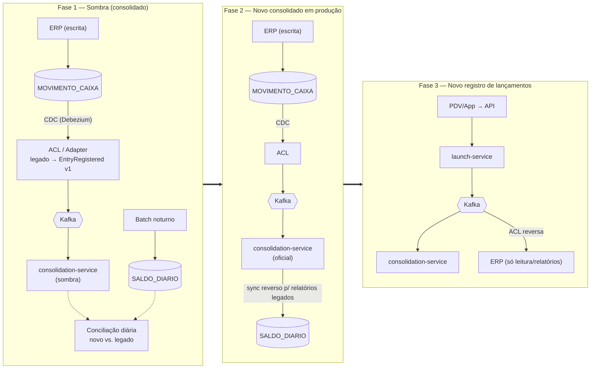

# 6. Arquitetura de transição (migração de legado)

O enunciado não descreve um legado. Para mostrar a estratégia, assume-se um cenário **realista e explícito**:

> **Legado hipotético:** um ERP monolítico on-premises em que o caixa grava na tabela `MOVIMENTO_CAIXA` de um banco relacional compartilhado por vários módulos. O saldo diário é calculado por um **job batch noturno** que grava em `SALDO_DIARIO`. Relatórios e outros módulos leem essas tabelas diretamente.

Problemas que motivam a migração: o saldo só existe no dia seguinte, o batch falha silenciosamente, o banco compartilhado acopla os módulos e escalar o ERP exige escalar o todo.

## 6.1 Estratégia: Strangler Fig + Anti-Corruption Layer + CDC

Nada de *big bang*. Cada fase é reversível e tem um critério de saída objetivo.

| Fase | O que muda | Critério de saída | Rollback |
|---|---|---|---|
| **0. Preparação** | Mapear o contrato do legado (campos, sinais, fusos, estornos). Construir a ACL. Carga histórica em lotes no novo read model. | Carga histórica conciliada a 100%. | Descartar o read model. |
| **1. Sombra** | CDC lê `MOVIMENTO_CAIXA` e a ACL traduz para `EntryRegistered v1`. O consolidado novo roda em paralelo, sem usuários. Uma conciliação diária compara novo e legado. | 30 dias seguidos com divergência 0 (ou explicada). | Desligar o CDC. |
| **2. Leitura no novo** | A consulta de saldo passa a vir do novo serviço (feature flag por comerciante, canário de 5% → 25% → 100%). O batch é desligado; um sync reverso alimenta `SALDO_DIARIO` para relatórios legados. | SLOs do consolidado cumpridos com 100% do tráfego. | Flag de volta para o legado; reativar o batch. |
| **3. Escrita no novo** | PDV/apps passam a registrar no `launch-service`. A ACL reversa replica os lançamentos para o ERP enquanto houver módulos dependentes. O CDC do legado é desligado por comerciante migrado. | Nenhum módulo grava mais em `MOVIMENTO_CAIXA`. | Comerciante volta a gravar no ERP; o CDC é religado. |
| **4. Desligamento** | Remover a ACL reversa quando nenhum módulo ler mais as tabelas legadas. | Tabelas legadas sem leitura por 60 dias. | — |

## 6.2 Pontos de atenção

- **Duplicidade durante a coexistência:** em cada fase, um comerciante tem **uma única origem de escrita**. A ACL gera `entryId`/`eventId` determinísticos a partir da PK legada, então reprocessar o CDC é idempotente no consumidor.
- **Semântica divergente:** se o legado permite UPDATE/DELETE de movimentos, a ACL converte a alteração em **estorno + novo lançamento**, preservando a imutabilidade do novo domínio.
- **Fuso e data:** a ACL normaliza a data financeira (o legado pode gravar `TIMESTAMP` sem fuso).
- **Por que o contrato de evento é o ponto de integração:** o consolidado novo não sabe se o evento veio do `launch-service` ou do legado. É essa decisão que permite migrar leitura e escrita em fases separadas.
